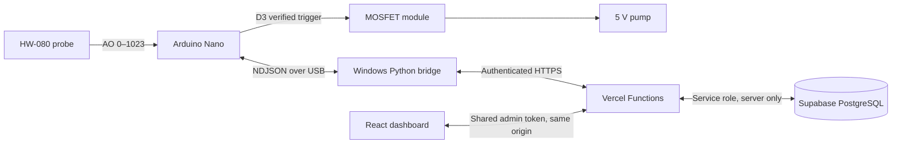

# Smart Plant Watering System

A complete personal IoT system for an Arduino Nano, HW-080 resistive moisture probe, 5 V pump, Windows serial bridge, Vercel dashboard/API, and Supabase PostgreSQL.

## Architecture and security assumptions



The Nano is the final safety authority. It boots with the pump off, filters readings, confirms dry soil over multiple samples, uses hysteresis, waters in bounded pulses, waits through a soaking interval, and stops at a local maximum even if USB or the internet disappears. Its last validated configuration is stored in EEPROM.

Vercel cannot access a local USB port. The Windows bridge owns the serial connection and forwards data with a server-side bridge token. Vercel Functions are deliberately short-lived; the bridge polls for expiring commands. A command is marked successful only after the Nano sends an acknowledgement. Claimed commands are not replayed after bridge reconnection.

This is a single-owner deployment. The dashboard asks for a separate admin token and stores it only in `sessionStorage`; it is not compiled into JavaScript. Supabase is never called from the browser. All tables have RLS enabled with no public policies, while Vercel alone uses the service-role key. For a multi-user/public product, replace the shared dashboard token with Supabase Auth or another identity provider and add per-user authorization.

## Repository tree

```text
plant-watering-system/
├── .github/workflows/ci.yml
├── firmware/plant_watering/plant_watering.ino
├── bridge/
│   ├── .env.example
│   ├── bridge.py
│   ├── requirements.txt
│   └── test_bridge.py
├── database/schema.sql
├── docs/protocol.md
├── web/
│   ├── api/
│   │   ├── _lib/{auth,http,policy,schema,supabase}.ts
│   │   ├── commands.ts, connectivity.ts, events.ts
│   │   ├── health.ts, history.ts, settings.ts
│   │   ├── status.ts, telemetry.ts
│   │   └── _lib/*.test.ts
│   ├── src/{api,App,main,styles,types}.ts(x)
│   ├── src/App.test.tsx
│   ├── .env.example
│   ├── index.html
│   ├── package.json
│   ├── tsconfig*.json
│   ├── vercel.json
│   └── vite.config.ts
├── .gitignore
└── README.md
```

## 1. Wiring and electrical safety

Power everything off while wiring.

| Part | Connection |
|---|---|
| HW-080 interface `VCC` | Nano `5V` |
| HW-080 interface `GND` | Nano `GND` |
| HW-080 interface `AO` | Nano `A0` |
| HW-080 interface `DO` | Unused |
| Switch module `TRIG/PWM` | Nano `D3` |
| Switch module logic `GND` | Nano `GND` and supply ground (common ground) |
| Switch power input | Regulated 5 V supply, observing `VIN+` / `VIN−` |
| Pump | Module output, observing `OUT+` / `OUT−` |

Do **not** power the pump from a Nano I/O pin, and preferably do not route pump current through the Nano's 5 V pin. Use a regulated 5 V supply sized for the pump's startup current, branch it to the pump module and Nano/USB as appropriate, and join grounds. Confirm that the module includes a flyback diode; if it does not, add an appropriately rated diode across the pump (cathode to pump positive). Add a 10 kΩ pull-down for active-high or pull-up for active-low trigger modules if the module has no input bias and reset glitches are possible.

### Verify trigger polarity before connecting the pump

Module labels and polarity vary, so the firmware defaults to `module_verified=false` and automation off.

1. Disconnect the pump. Power the Nano and module, and measure the module output or use a safe test load.
2. Upload the firmware. In the dashboard, leave automation off, choose active-high or active-low, check **MOSFET verified**, and save.
3. Request a 0.5-second manual pulse and confirm the output turns on only for that pulse and remains off through reset.
4. If behavior is inverted, uncheck verification, save, change polarity, and repeat.
5. Only after the test passes should the pump and water tubing be connected. Keep electronics above and away from water.

## 2. Flash the Nano

1. Install Arduino IDE 2.x and connect the Nano by USB.
2. Open `firmware/plant_watering/plant_watering.ino`.
3. Select **Arduino Nano**, the correct processor/bootloader for the board, and its COM port.
4. Upload. Open Serial Monitor at **115200 baud**; a JSON `boot` line followed by telemetry should appear.

No Arduino library is required beyond the standard core and EEPROM library. The serial message contract is in [`docs/protocol.md`](docs/protocol.md).

## 3. Create Supabase data storage

1. Create a Supabase project.
2. Open **SQL Editor**, paste `database/schema.sql`, and run it once.
3. In **Project Settings → API**, copy the project URL and service-role key. Treat the service-role key like a password. It belongs only in Vercel.
4. The SQL creates the `nano-plant-01` device and conservative defaults. Change `DEVICE_ID` consistently in firmware, bridge `.env`, and `web/src/api.ts` if another ID is needed.

The schema includes indexes, constraints, RLS, expiring commands, unique idempotency keys, and an atomic `claim_next_command` function using `SKIP LOCKED`.

## 4. Run and test the web project locally

Requirements: Node.js 20 or 22 and npm.

```powershell
cd web
Copy-Item .env.example .env.local
npm install
npm test
npm run build
npx vercel dev
```

Fill `.env.local` before `vercel dev`:

| Variable | Purpose |
|---|---|
| `SUPABASE_URL` | Supabase project URL |
| `SUPABASE_SERVICE_ROLE_KEY` | Server-only database credential |
| `BRIDGE_API_TOKEN` | Long random token used only by the bridge/API |
| `DASHBOARD_ADMIN_TOKEN` | Different long random token entered in the dashboard |

Generate each token independently, for example: `python -c "import secrets; print(secrets.token_urlsafe(48))"`.

Vite alone (`npm run dev`) serves the UI but not Vercel Functions; use `npx vercel dev` for the complete local stack. The project contains no simulated readings. Empty graphs explicitly wait for real telemetry.

## 5. Install the Windows bridge

```powershell
cd bridge
py -m venv .venv
.\.venv\Scripts\Activate.ps1
pip install -r requirements.txt
Copy-Item .env.example .env
python bridge.py --list-ports
pytest -q
python bridge.py
```

To identify the port, run `python bridge.py --list-ports` once with the Nano unplugged and once after plugging it in. Use the new `COM` entry. Device Manager → **Ports (COM & LPT)** shows the same information. Some clone Nanos require a CH340 USB driver from the board vendor.

Set `API_BASE_URL` to `http://localhost:3000` during `vercel dev`, or the production HTTPS URL after deployment. Set the same `BRIDGE_API_TOKEN` in the bridge and Vercel. The bridge reconnects with exponential backoff, reports health every 10 seconds, validates all serial JSON, and never creates or replays a watering command on reconnect.

For unattended use, start it at sign-in with Windows Task Scheduler:

- Program: the absolute path to `bridge\.venv\Scripts\python.exe`
- Arguments: the absolute path to `bridge\bridge.py`
- Start in: the absolute `bridge` directory (so `.env` is found)
- Enable “Restart the task if it fails” with a one-minute interval.

## 6. Calibrate with real soil

The supplied readings suggest “drier = higher,” but each probe, soil, salinity, and supply differs.

1. Disable automation and keep the pump disconnected.
2. Record the stable filtered reading in soil at the driest level you will allow. Set `dry_threshold` slightly below that value (for example, if stable dry is 1022, begin around 950–980).
3. Fully water the pot, let excess water drain, wait for distribution, and record the stable reading. Set `wet_threshold` slightly above the wet reading.
4. Maintain at least 21 ADC counts between wet and dry thresholds. Start with short pulses and a long soaking interval.
5. Verify several cycles while present before enabling unattended automation.

The state is `dry` at or above the dry threshold, `wet` at or below the wet threshold, and `normal` between them. Consecutive dry readings trigger a pulse; the dry counter resets only at the wet threshold, providing hysteresis.

## 7. Deploy with GitHub and Vercel

From the repository root:

```powershell
git init
git add .
git commit -m "Build safe plant watering system"
git branch -M main
git remote add origin https://github.com/YOUR_ACCOUNT/plant-watering-system.git
git push -u origin main
```

In Vercel:

1. Import the GitHub repository.
2. Set **Root Directory** to `web` and framework preset to **Vite**.
3. Add all four variables from `web/.env.example` to Production and Preview as appropriate.
4. Deploy. Vercel will run `npm run build`; `/api/health` should return `{ "ok": true, ... }`.
5. Open the deployed dashboard, enter `DASHBOARD_ADMIN_TOKEN`, and confirm it shows the bridge offline rather than fake data.
6. Put the deployment URL in `bridge/.env`, start the bridge, and confirm “DEVICE ONLINE,” a fresh timestamp, and real chart points.
7. With the pump still disconnected, complete the polarity test. Then test a short manual pulse and wait for the command state to become `acknowledged`.

Optional Vercel CLI deployment:

```powershell
cd web
npm install
npm test
npm run build
npx vercel
npx vercel --prod
```

## API summary

| Route | Method | Credential | Purpose |
|---|---|---|---|
| `/api/telemetry` | POST | Bridge bearer token | Telemetry, boot, and device errors |
| `/api/events` | POST / GET | Bridge / dashboard | Watering events |
| `/api/status` | GET | Dashboard | Overview and latest command |
| `/api/history?range=24h\|7d` | GET | Dashboard | Chart readings |
| `/api/settings` | GET / PUT | Bridge or dashboard / dashboard | Read/save settings |
| `/api/commands` | POST / GET / PATCH | Dashboard / bridge / bridge | Queue, claim, acknowledge |
| `/api/connectivity` | POST / GET | Bridge / dashboard | Bridge heartbeat and diagnostics |
| `/api/health` | GET | Public | Stateless deployment check |

Remote watering requires an online bridge, a connected serial port, verified module polarity, valid duration, unique idempotency key, and rate-limit clearance. It expires after 20 seconds. Firmware validation and maximum runtime still apply.

## Tests

- Bridge: valid/invalid serial parsing, device identity, deterministic setting commands, and reconnect behavior that cannot synthesize watering.
- API helpers: authentication failure, invalid telemetry/settings, stale bridge, expired command, and duplicate request detection.
- Dashboard: locked/loading and API/database failure states.
- CI: Python tests, web tests, and production build on every push and pull request.

Hardware-in-the-loop tests are intentionally not claimed here. Perform the disconnected-pump polarity procedure and supervised wet/dry calibration on the actual components.

## Troubleshooting

| Symptom | Checks |
|---|---|
| No COM port | Try another data-capable USB cable/port; check Device Manager; install the board vendor's USB driver. |
| Port access denied | Close Arduino Serial Monitor and other serial programs; only one process can own the COM port. |
| Garbled serial output | Both sides must use 115200 baud; reflash the exact firmware. |
| Dashboard says bridge offline | Confirm bridge is running, production URL is correct, tokens match, Windows clock is correct, and `/api/health` works. |
| 401 from API | Do not swap the bridge and dashboard tokens; remove whitespace added during copy/paste. |
| 500/database unavailable | Check Supabase URL/service key in Vercel and run the full schema. Review Vercel Function logs without printing secrets. |
| Water command rejected | Check bridge online, serial connected, module verified, duration below maximum, and the 10-second/three-per-minute limits. |
| Command stays delivered | The bridge wrote it to serial but did not receive a matching Nano acknowledgement; inspect cable, baud rate, and serial logs. It will not replay automatically. |
| Pump runs at boot | Disconnect power immediately. Polarity/configuration or module input bias is wrong; retest without the pump and add the appropriate pull resistor. |
| Erratic moisture values | Shorten sensor wires, confirm common ground, average in stable soil, keep pump current wiring away from A0, and check corrosion. |

## Hardware limitations and next extension

Resistive probes corrode through electrolysis and their readings drift with fertilizer, salinity, temperature, and probe placement. Replace with a capacitive probe for longer-term use, or switch sensor power with another safe output so it is energized only during readings.

There is no reservoir-level sensor. The system can command a dry pump or pump air if the reservoir empties. The next recommended extension is a normally-closed float switch or non-contact level sensor wired to a dedicated Nano input; firmware should treat “reservoir empty” as a latched inhibit, stop the pump immediately, report the fault, and require the level to recover before watering.
